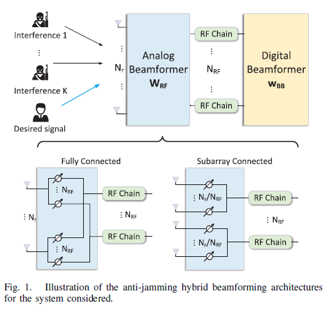
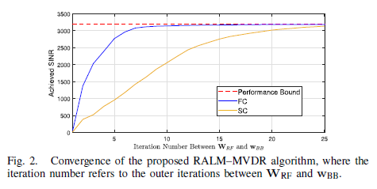
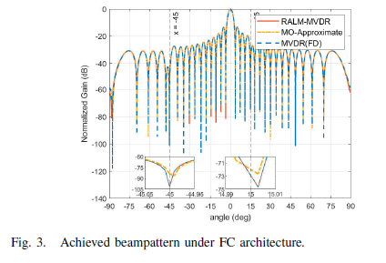
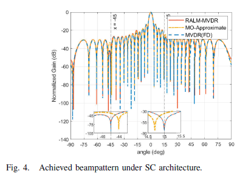
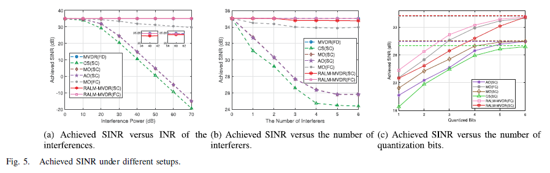

# [MIMO & Anti-interference simulation and practical combat]Disassembly｜Millimeter-wave receiver anti-interference"Last mile": From constant modulus constraint to moving sub-arrays[End of the text: Attached code link]

[MIMO & Anti-interference simulation and practical combat]Disassembly｜Millimeter-wave receiver anti-interference"Last mile": From Constant Mode to Moving Subarray Section: MIMO & Anti-interference simulation and practical combat ｜ This is a summary. 12 Minutes ｜ The core segment at the end of the text can be directly reproduced. Many people think that hybrid beamforming (HBF)The anti-interference is to..."All digital MVDR Solution"Approximate it here, anyway, the phase shifter only needs one phase difference, as long as the main lobe shape is correct..  
The actual situation is: the depth of null-depth in interference direction. It is the real lifeline of mixed architecture anti-interference. The approach of using Euclidean distance to approximate the full-digit solution. The main lobe can be learned to look very much like. However, the null-depth of interference direction is shallow and biased - interference is strong. One more, Immediately drop in SINR. This article starts with "Why Approximation Fails". Step by step, dismantle to the "augmented Lagrangian + complex analytic manifold" and "movable sub-array" two-layer solution. Finally, provide the core segment with comments. You can directly take it and reproduce the idea.
01 First, recognize a physical reality: the lack of RF chains leads to insufficient degrees of freedom. Millimeter wave relies on large arrays for beamforming gain, but each antenna requires its own RF chain, leading to a direct explosion in cost when the array is large. The compromised solution for hybrid architectures is to use Q RF chains, each connected to a subarray through phase shifter networks. The received signals are first down-sampled at the analog end (block diagonal, constant modulus and normalized for each active element), then merged at the digital end.
The classic MVDR anti-interference idea is "expect the direction of fixed unit gain." Minimize the output interference and noise power. Once the "Each phase shifter can only adjust its phase" constant modulus constraint is applied, The problem immediately becomes non-convex. No closed-form solution. Joint variables are highly coupled. This is the first pitfall of mixed architecture interference: the problem is not difficult to calculate. Rather than most practices, it's about calculating a "looks like". Actually, it's not about the issue of proxy.
02 Root of the Approximation Method: The "Deep Zero Sink" is not included in the agent objective. When receiving interference, use the geometric channel model.
Represents various signals, and the interference plus noise covariance is  .
Two-stage approximation method first calculates the full digital optimal weights, then solves  .
This objective matches the "What is the shape of a digital weight?" rather than "Has the interference direction been eliminated?". The deep nulls in the digital domain come from the precise cancellation of individual degrees of freedom, compressed into a chain and then approximated using least squares. The depth of nulls is sacrificed first. A typical scene in simulation (with accompanying images: beampattern comparison, fig03_beampattern.png): the nulls of an approximation-based hybrid baseline are deeper by 10~20 dB or even deeper than those of FD-MVDR, often deviating in angle; interference strength leads to more severe errors being magnified.
Solution 1: Solve the original problem directly on the constant modulus manifold, constraining it with an Augmented Lagrangian that combines both soft and hard constraints. Can we avoid the proxy problem? Yes. The constant modulus set itself is smooth complex circle manifolds, and gradient descent on the manifold (projecting the Euclidean gradient onto the tangent space, along geodesic/contraction updates, Armijo line search) can ensure each step satisfies the constant modulus. The remaining challenge: no lossless constraint cannot be automatically satisfied by plain manifold descent. The idea behind RALM is to write the constraint as a quadratic equation and incorporate it into the objective:
where. The multipliers and penalty parameters are updated alternately according to rules: if progress is made, do not move; if progress stalls, increase or decrease based on scaling, using standardized Augmented Lagrangian steps with bounded clipping. The substructure connection structure uses a mask matrix for Hadamard product, restricting the gradient to "real-world phase shifters," maintaining a block diagonal hardware structure without destroying one step at a time. This is the core of RALM–MVDR (IEEE WCL 2026, DOI: 10.1109/LWC.2026.3665220).
An engineering-friendly trick is "Digital MVDR variable projection": the digital end already has closed-form solutions—letting, then  
automatically satisfy. Replacing it back into SINR, the remaining goal is just
The penalty parameters, multipliers, and equality constraints have been eliminated. The comparison we replicated confirms that the original structure of "augmented Lagrangian manifold inner layer + MVDR outer layer" converges faster than "variable projection + Riemannian L-BFGS", requires fewer iterations in the manifold, and yields higher final SINR.
Solution Two: True "physical cracking" of spatial correlation - making subarrays move while fixing the array Another issue that cannot be solved by both an iterative approximation and RALM is when the desired direction is too close to the interference direction, resulting in almost linearly correlated steering vectors. In scenarios where the interference is between 2°~5° and the desired is at 0°, there is not enough freedom of physical movement to simultaneously achieve "unit gain + deep nulls".
The solution for moving antenna (MA) is very simple: the steering vector is a continuous function of position, so moving the subarrays and changing the phase relationship between elements can effectively "redraw the array manifold". According to the field response (FRI) model, if the center of the first subarray is at, the internal element spacing, and the positions of the elements are, then  
is the coordinates of all elements. The desired channel is the superposition of multipaths. Thus, position becomes an optimization variable in the objective function - the degrees of freedom for position and the simulation phase freedom are two complementary dials.
The difficulty lies in feasibility: four rigid short-line arrays share a guide rail, and the center must satisfy local intervals, fixed ordering, and minimum center distance across subarrays (ensuring that the boundary elements of the cross-subarray are not less than, physically compatible). Three constraints are coupled together, making direct projection cumbersome. A nice approach is to transform variables:  
Then  
ordering + minimum distance becomes a monotonically non-decreasing constraint; when the nominal center distance exactly equals, each coordinate shares the same upper and lower bounds, so the precise Euclidean projection of "box + non-increasing" intersection = PAVA preserving order + unified truncation, with linear complexity achieved in one step. The position update uses Armijo backtracking: explore points, if the target does not increase, then half the step size (initial, lower bound).
05 Complete Loop: Estimation, Reconstruction, and Joint Optimization, Without One Missing Out on Real Covariance
What to do when the real covariance cannot be obtained? This might be the most common pitfall for all "paper-based algorithms." This set of engineering has also completed the training pipeline: four subarrays are stationary at feasible positions, switching scanning states to perform compression observation (legal pilot 64 snapshots, interference monitoring 128 snapshots), and then using a shared angle domain supported multi-state SBL to recover the angle domain FRI—simultaneously appearing of the same batch of interference in all training observations, joint sparse estimation is much more accurate than independent estimation at each position. With the spatial power distribution of interference, any candidate position can reconstruct the channel with the FRI model, including from untrained positions.
The next step is the optimization main loop: fixed position → Manopt runs R-LBFGS update simulation phase on complex circle manifold; fixed simulation → PAVA project gradient updates subarray positions; digital end by MVDR exact factorization - outer layer up to 50 rounds, relative gain below convergence. Finally, evaluate output SINR on the true model instead of fooling oneself with estimated models.
Why insist on forming an "estimation—reconstruction—optimization" closed loop? Because only looking at optimization without estimation easily overestimates the algorithm's usability: real systems cannot obtain, so they have to guess with training observations. The significance of this closed loop lies in translating "guessing accuracy" into final performance metrics—regional reconstruction error first converted into SINR loss, then answering "this scheme can be used". In scientific writing, it is also recommended to adopt this perspective: do not only report SINR on the estimated model, but report results on the true model for persuasiveness.
How to read the results: six conclusions that can directly write into reports according to WCL receiver scale, etc., can be reproduced in the mobile interval, and 11 sets of figures can be condensed into six:
1  
Approaching upper bound: output SINR approaches full digital MVDR, significantly lagging behind a hybrid baseline approximation at high INR (fig04, fig05).
Strong interference resistance: INR 0→70 dB performance is almost flat, and the near-baseline approach significantly deteriorates with an increase in INR.
3  
Anti-interference: Interference 1→6, performance still adheres to FD-MVDR.
4  
Quantization resistance: Phase shifter 1-6 bits, almost continuous phase with 4 bits and above (fig.06).
5  
Positional freedom is a true gain: the near angle interference interval 1°→20°, point-by-point re-estimation and re-design, the estimated FRI still significantly outperforms fixed arrays; as the moving range increases, the gain first rises then saturates and shows spatial periodicity (fig07, fig08). Ablation experiments prove that positional freedom, simulated phase freedom, and joint optimization are indispensable (fig10).
6  
Estimated cost controllable: 5 training locations + 128 interference snapshots are sufficient, and the region reconstruction error has a minimal impact on the final SINR (fig09). The solver comparison shows that variable projection R-LBFGS achieves an optimal solution (fig11).
Finally, a reading reminder: The results are divided into three groups to be analyzed—the first group (fig01/fig09) answers "Is the channel estimation sufficient?"; the second group (fig02~fig06) answers "Optimization and anti-interference themselves"; the third group (fig07/fig08/fig10) answers "What is the cost of positional freedom?". fig11 separately answers "The cost of solver structure." Do not use fig07 to prove the channel estimation, nor use fig01 to prove the depth of nulling. Each figure corresponds to a specific problem, ensuring that the conclusions do not mix.
07 Reproducing Default Conditions and Three Most Commonly Mistaken Details
First, provide a default scenario that can be directly copied into the configuration file: root element, RF chain, each subarray, internal spacing, local moving range, minimum center spacing of common guide rails; three legal user paths, total received power of 20 dB; default interference, etc., with each INR of 20 dB - intentionally placing near and far angles at the same time to test the MA's ability to reconstruct spatial correlation. Training uses 5 guide rail positions, 8 DFT-type subarray connections per position, 64 pilot snapshots, 128 interference listening snapshots; grid for the angle domain, step size. Optimize side outer layer AO up to 50 rounds, convergence tolerance.Simulation endpoint Manopt R-LBFGS (memory 20, 120 iterations); positional endpoint initial step size for projection gradient, backtracking coefficient 0.5, lower bound; random experiments uniformly follow the main seed 20260902 derived deterministic seeds, Monte Carlo fixed at 10 times, only plotting the mean.
In comparison to this configuration, there are three implementation details that are most prone to errors. It is recommended to highlight these points before writing code:
1  
The position gradient must treat interference as a function of position. Only the desired channel is differentiated. Treat as constants. It is the most concealed error - the position block will "think" it's optimized very well. In real-life scenarios, any disturbance immediately reveals the truth.
2  
The substitution only yields precise projection when "nominal spacing = minimum spacing". This is because the coordinates after substitution share the same upper and lower bounds, ensuring preservation of order before truncation for precise Euclidean projection; otherwise, a generalized convex projection must be solved directly instead of truncation.
3  
Normalize the simulated endpoints separately. Each phase shifter in the code should be adjusted and recalculated repeatedly to ensure that the block diagonal structure is satisfied and the numerical modulus does not drift. Without this step, all SINR metrics will be biased.
08 Core Segment: You can directly copy the three segments of code, which represent the closed-form solution (without distortion constraints being precisely eliminated) of the MVDR algorithm.
function result = update_digital_mvdr(model, c, z, cfg)  % w = C{-1}g / (gH C{-1}g)\nPositional projection (box constraint) + Sort + Minimum spacing replaced with PAVA):   
function c = project_common_rail_positions(x, cfg)  shift = (0:cfg.Q-1).' * cfg.position.min_center_spacing; y = pava_nondecreasing(x - shift); % Ordered regression y1 <= ... <= yQ y = min(max(y, common_lower), common_upper); c = y + shift;% Reduction sub-matrix center end
Reproduce all paper figures with a single click (environment: MATLAB R2020b+, simulating manifold optimization reuse Manopt):
Run submission figures; % Main core figure suite = run_paper_suite('all', false); % All 11 group figures
This period's summary and next period's forecast: the essence of this period's "last mile" is two questions: are you really optimizing the true anti-interference target, or are you just fooling around with a seemingly proximate target? Are your arrays fixed, or can they be supplemented by physical degrees of freedom to achieve spatial separability? For the former, the answer is manifolds + extended Lagrange/variable projection; for the latter, the answer is to have subarrays "reasonably and legally move on the common guide rails."The combination of the two ensures that the system can maintain a stable output in extreme scenarios such as strong interference (INR 70 dB), multiple interference, and near angle interference.
Let's also be honest about the applicable boundaries. This facilitates everyone's ability to determine the application of this set: The simulation scenario is a single-expectation signal receiving end anti-interference in narrow band array manifold. Interference and expectation are assumed to be far-field plane waves. Angle slow change; Position adjustment is driven by a motor. Suitable for static or slow-varying scenarios with millisecond channels. Inappropriate for channel coherence time of short-duration high-speed motion compensation. To broadband OFDM Multi-user, multi-zero-crossing Expanded beamforming on the transmit side. Additional constraints need to be introduced separately. This is a direction that can be expanded upon in the future. Make the applicable boundaries clear. More valuable than the conclusion of "one move, conquer all".

## Images

<!-- PAYMENT_BLOCK -->

## Get this dataset

- Payment link (Stripe): [Buy now](https://buy.stripe.com/3cs8yP7sY87d0vu9AB)
- Payment QR code: 

<!-- /PAYMENT_BLOCK -->
